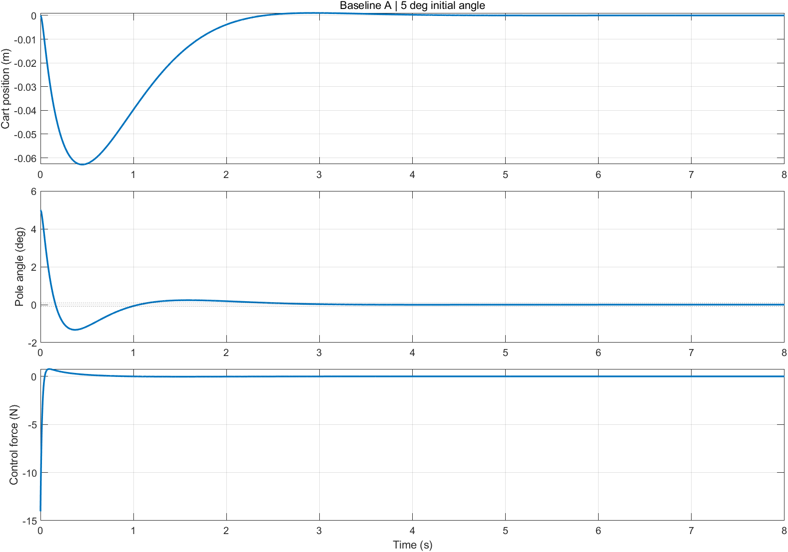
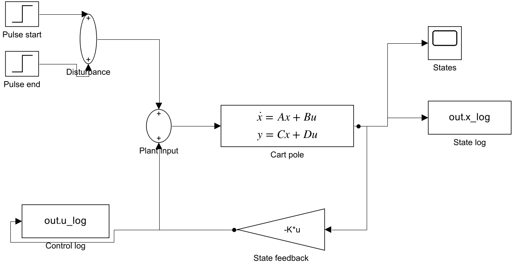

# LQR 倒立摆本科论文复现

**WANG Zheng / 王正 · MATLAB R2024b + Simulink · 建模 / 状态反馈 / 仿真验证**

以本人本科毕业论文《基于 LQR 控制的一阶倒立摆 Simulink 仿真》为依据，重新实现可运行的代码与模型。项目展示从物理参数、动力学建模、LQR 设计到仿真和数值交叉验证的过程。

> 本仓库是后续重新实现，不是原始论文源代码备份；结果均为仿真。部分扰动指标与论文不同，见[复现结果与差异](docs/RESULTS.md)。



## 快速查看

- [模型推导与符号约定](docs/MODEL.md)：物理参数、角度方向修正、A/B 矩阵及指标定义。
- [复现结果与差异](docs/RESULTS.md)：三组 Q/R 比较、扰动实验和核验说明。
- [来源及贡献边界](docs/PROVENANCE.md)：本科研究与本次整理新增内容的区别。
- [机器可读指标](results/metrics.json)、[三组参数指标表](results/initial_metrics.csv)。
- [可直接打开的 Simulink 模型](models/)及[自动测试](tests/)。

## 运行

需要 **MATLAB、Control System Toolbox、Simulink**。已在 MATLAB **R2024b** 验证，其他版本未验证。

```matlab
% 将 MATLAB 当前目录切换到本仓库根目录
report = run_reproduction;  % 重新生成 .slx、CSV、PNG 和 metrics.json
results = runtests('tests');
assertSuccess(results);
```

命令行也可在仓库根目录运行：

```text
matlab -batch "run_reproduction; r=runtests('tests'); assertSuccess(r)"
```

运行前请关闭本项目同名 Simulink 模型。生成结果写入 `results/` 和 `models/`，会更新已有生成文件。无需下载数据集，不需要机器人硬件。

只有 MATLAB 和 Control System Toolbox 时，可运行数值计算及基础测试：

```matlab
addpath('src');
s = simulate_case('A','initial');
pulse = simulate_case('A','pulse');
r = runtests('tests/test_reproduction.m');
assertSuccess(r);
```

### 直接打开模型

```matlab
open_system('models/cartpole_lqr.slx');
```

模型的参数保存在 **Model Workspace**，不依赖预先向 base workspace 注入变量。`cartpole_open.slx` 为开环，`cartpole_lqr.slx` 为 A 组初始偏角实验，`cartpole_pulse.slx` 为 2 N / 0.2 s 扰动实验。需要研究 B/C 时，可修改模型工作区 K，或直接使用 `simulate_case('B','initial')` / `simulate_case('C','initial')`。



## 展示的技术内容

1. 从质量、质心距离、转动惯量和阻尼参数构建四维状态空间模型；明确几何符号约定。
2. 设计连续时间 LQR 全状态反馈，对比增大 R 和增大 Q 的控制代价与响应变化。
3. 通过 MATLAB 数值积分、矩阵指数解析解与 Simulink 独立模型核对计算。
4. 导出每条状态轨迹、控制力和扰动力，明确峰值、误差带及调节时间的计算口径。
5. 用自动测试检查可控性、Riccati 残差、闭环极点、非线性 Jacobian、脉冲与采样边界。

## 文件结构

```text
run_reproduction.m      一键计算与生成入口
src/                    模型、LQR、分段仿真、指标、Simulink 构建器
models/                 三份可打开运行的 .slx
tests/                  数值与 Simulink 交叉验证
results/                原始曲线 CSV、指标 JSON / CSV、图表
docs/                   模型说明、结果对照、来源与范围
```

**适用范围：** 平衡点附近线性控制仿真；不代表实物稳定性、执行器性能或大角度摆起能力。无噪声与输入饱和，完整状态可测。非线性扩展仅作为本次重实现的一致性检查。
