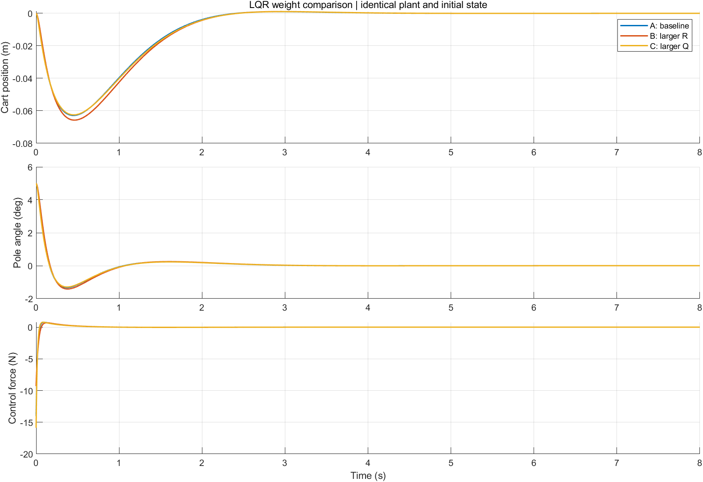
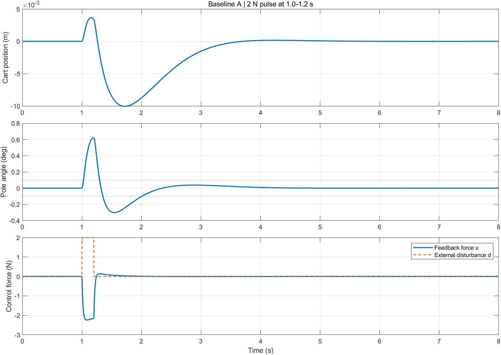

# 实际运行结果与论文对照

环境：MATLAB R2024b、Control System Toolbox、Simulink。详细数值由运行入口自动输出到 [`results/metrics.json`](../results/metrics.json)。下面的数值来自本次真实运行，没有用论文值覆盖结果。

## 三组权重：初始摆角 5°

| 方案 | 论文位移峰值 / m | 复现位移峰值 / m | 论文控制力峰值 / N | 复现控制力峰值 / N | 论文摆角调节时间 / s | 复现调节时间 / s |
|---|---:|---:|---:|---:|---:|---:|
| A | 0.0628 | 0.0628351 | 14.0434 | 14.0434222 | 2.43 | 2.422 |
| B | 0.0657 | 0.0657270 | 9.3111 | 9.3111189 | 2.47 | 2.463 |
| C | 0.0625 | 0.0624858 | 15.8671 | 15.8671370 | 2.44 | 2.437 |

位移和控制力峰值与论文四位小数一致。三组最大绝对摆角均为初始 5°。

这里用 1 ms 输出采样、±0.1° 误差带和“最后越界后保持在带内”的口径。A 组若改用 10 ms 输出采样，测得 **2.43 s**，与论文一致。这说明输出采样可以解释该量级的差别，但原始工程未找到，不能确定论文当时确实采用该采样设置。

增大 R 后，控制力峰值下降、摆角调节时间略延长；增大 Q 后，位移峰值略减小、控制力峰值增大。A 为论文选定的折中基准，不宣称它在所有指标上都最优。

## 矩形脉冲：2 N，1.0–1.2 s，零初态

| 指标 | 论文值 | 本次复现值 | 判断 |
|---|---:|---:|---|
| 小车位移峰值 | 0.0105 m | 0.0100344 m | 不一致，约低 4.43% |
| 摆角峰值 | 0.6232° | 0.623098° | 接近，约差 0.000102° |
| 反馈控制力峰值 | 2.1475 N | 2.239428 N | 不一致，约高 4.28% |
| 摆角恢复至 ±0.1° | 0.83 s | 0.809 s | 存在差异；本次从脉冲结束起计 |
| 位移恢复至 ±0.002 m | 1.72 s | 1.694 s | 存在差异；本次从脉冲结束起计 |

**本次没有完整复现论文的全部扰动指标。** 为区分代码错误和报告差异，进行了三种核验：

1. 分段 `ode45`，在两个脉冲边缘重新启动积分。
2. 用独立矩阵指数解析式求矩形脉冲响应：`F=A-BK`，单个阶跃响应为 `F\((expm(F*t)-I)*B*2)`，再将相隔 0.2 s 的两个阶跃相减。
3. Simulink 中使用两个 Step 模块、State-Space 对象和独立反馈环路。

解析解与数值积分的最大状态差约 `1.66e-12`；Simulink 扰动轨迹与数值积分的最大状态差约 `2.27e-12`。输出采样从 1 ms 减半到 0.5 ms，位移峰值未发生可见变化。因此，不能把约 4% 的差别简单解释为当前数值积分不够精细。原始 `.m/.slx` 未找到，论文计算口径或当时配置仍无法确认。

## 验证与边界

- 可控矩阵满秩 4；基准 CARE 相对残差约 `1.64e-14`。
- A 组闭环极点约为 `-58.6581, -7.0134, -1.6313 ± 1.2397i`。
- Simulink 基准初始响应与 MATLAB 积分最大状态差约 `1.46e-11`。
- 开环轨迹为发散线性模型，数值幅度大；Simulink 与积分的最大绝对状态差约 `2.15e-6`，测试按轨迹规模归一化比较。
- 核验包含模型 Jacobian、解析响应、误差带最后越界算法及模型文件重建。运行 `runtests('tests')` 可自行复查。
- 未验证实物、噪声、输入限幅、离散采样控制、建模误差鲁棒性或大角度摆起。某一次短脉冲恢复不等于已证明广义鲁棒性。

## 本次附加的非线性对照

同一 A 组控制器作用于符号一致的非线性动力学，5° 初态下位移峰值约 `0.0632389 m`，摆角调节时间约 `2.426 s`。结果仅表示本次小角度工况的线性/非线性对照，不替代原论文工况，也不是硬件实验。
